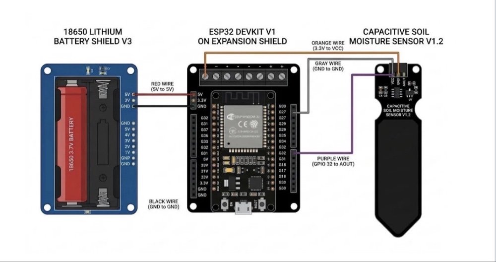

# Smart Attendance & Lecture Management System

**Author:** Ali Nihad Qadir  
**Institution:** Middle Technical University / Polytechnic College, Baghdad, Iraq  
**Year:** 2026  
**License:** All Rights Reserved — See [LICENSE](./LICENSE)

---

## Overview

A production-grade, 100% offline Smart Attendance System built for university lecture halls. The system combines real-time AI face recognition with hardware RFID card scanning to automate dual-factor attendance logging, enforce strict per-section academic isolation, and generate cumulative semester analytics with official RTL-formatted Excel reports — all without any internet connection, cloud services, or external CDNs.

**Technology Stack:**

| Layer | Technology |
|---|---|
| Web Framework | FastAPI (Python) with Uvicorn ASGI |
| Face Recognition | InsightFace `buffalo_s` via ONNX Runtime (CPU-optimized) |
| Camera Pipeline | OpenCV with multi-threaded MJPEG streaming |
| RFID Hardware | ESP32-S DevKit V1 + MFRC522 RC522 reader over USB serial |
| Database | Python built-in `sqlite3` with WAL mode and foreign key constraints |
| Real-time Updates | WebSocket (FastAPI native) for live attendance notifications |
| Excel Export | `openpyxl` — dual-sheet RTL institutional reports |
| Frontend | Inline server-rendered HTML/CSS/JS (zero external dependencies) |

---

## Architecture

```
                      PC (Offline — No Internet)
                 +-------------------------------+
                 |  FastAPI + Uvicorn (port 8000)|
                 |                               |
  USB Camera --> |  OpenCV  -->  InsightFace     |
                 |  MJPEG stream  512-d embeddings|
                 |                               |
  ESP32 RFID --> |  Serial listener (115200 baud)|
   (COM5)        |  UART UID:XX:XX:XX:XX packets |
                 |                               |
                 |  SQLite (attendance.db)        |
                 |  students / lectures /         |
                 |  attendance_records            |
                 +-------------------------------+
                     |           |
                  Browser     .xlsx reports
               (127.0.0.1)   (reports/ dir)
```

**Key design decisions:**

- Embeddings stored as raw `float32` BLOBs in SQLite — no external vector store required.
- Frame-skipping (every 3rd frame processed) keeps CPU usage manageable on Intel Core i5.
- `numpy.fromfile` + `cv2.imdecode` used for image loading to handle Arabic/Unicode file paths on Windows.
- RFID listener runs as a background daemon thread with 2.5-second software debounce per UID.
- Section isolation enforced at both face recognition and RFID scan: students from other sections are identified but blocked from being marked present.

---

## Hardware Wiring — ESP32 DevKit V1 + 18650 Battery Shield V3 + MFRC522

The RFID subsystem uses an ESP32 DevKit V1 on an expansion shield, powered by an 18650 lithium battery shield, communicating with an MFRC522 RC522 RFID reader over SPI. The ESP32 connects to the host PC over USB and transmits scanned UID strings over serial at 115200 baud.

### Wiring Diagram



> Note: The diagram above shows the expansion shield variant. The pinout table below reflects the actual GPIO connections used in this project.

### Pinout Table

| From | To | Wire Color | Notes |
|---|---|---|---|
| Battery Shield 5V | ESP32 5V | Red | Main power supply rail |
| Battery Shield GND | ESP32 GND | Black | Common ground |
| ESP32 3.3V | RC522 3.3V (VCC) | Orange | **MFRC522 operates strictly at 3.3V. Never connect VCC to 5V — the chip will be permanently damaged.** |
| ESP32 GND | RC522 GND | Gray | |
| ESP32 GPIO 5 | RC522 SDA / SS | Brown | SPI chip select |
| ESP32 GPIO 18 | RC522 SCK | Yellow | SPI clock |
| ESP32 GPIO 23 | RC522 MOSI | Green | SPI master-out |
| ESP32 GPIO 19 | RC522 MISO | Blue | SPI master-in |
| ESP32 GPIO 22 | RC522 RST | Purple | Hardware reset |
| RC522 IRQ | Not Connected | — | IRQ pin unused; polling mode is used instead |

### ESP32 Firmware

The ESP32 firmware reads RFID UID bytes over SPI, formats them as `UID:XX:XX:XX:XX`, and transmits the string over USB serial (115200, 8N1) every time a card is detected. The Python listener (`RFIDSerialManager` in `main.py`) parses these packets using a regex and routes them to the attendance pipeline.

---

## Project Structure

```
smart-attendance/
├── main.py              # FastAPI server — routes, video pipeline, WebSocket, RFID listener
├── database.py          # SQLite3 repository — schema, CRUD, cumulative analytics
├── pkg_resources.py     # Offline shim for Python 3.12+/3.13 compatibility
├── rfid_cards.json      # Test RFID card UID-to-name mappings (for development)
├── requirements.txt     # Pinned production dependencies
├── .gitignore           # Excludes attendance.db, known_faces/, models/, reports/
├── LICENSE              # All Rights Reserved — Ali Nihad Qadir, 2026
├── README.md            # This file
└── docs/
    └── wiring_diagram.jpg   # ESP32 + Battery Shield + MFRC522 hardware wiring diagram
```

The following directories are created at runtime and excluded from Git:

| Directory | Contents |
|---|---|
| `known_faces/` | Reference face photos used for biometric enrollment |
| `models/` | InsightFace `buffalo_s` ONNX model weights (auto-downloaded on first run) |
| `reports/` | Generated `.xlsx` report files (single-session and cumulative) |
| `attendance.db` | SQLite database (students, lectures, attendance records, settings) |

---

## Installation & Local Execution

### Prerequisites

- Python 3.10, 3.11, or 3.12 (Python 3.13 also supported via the included `pkg_resources.py` shim).
- A USB webcam or built-in laptop camera (720p at 30 FPS or higher).
- Optional: ESP32-S DevKit V1 with MFRC522 reader, connected on COM5 at 115200 baud. The system starts and runs fully without RFID hardware present.

### Step 1: Clone the Repository

```bash
git clone https://github.com/your-username/smart-attendance.git
cd smart-attendance
```

### Step 2: Create and Activate a Virtual Environment

```bash
python -m venv .venv

# Windows (PowerShell)
.\.venv\Scripts\Activate.ps1

# Linux / macOS
source .venv/bin/activate
```

### Step 3: Install Dependencies

```bash
pip install -r requirements.txt
```

### Step 4: First-Run Model Download

On first launch, InsightFace downloads the `buffalo_s` model bundle (~100 MB) into the local `models/` directory. After the first run, the system is fully offline.

For air-gapped environments: download the model on a connected machine, copy the `models/` directory to the target machine, and launch normally.

### Step 5: Run the Application

```bash
python main.py
```

Then open a browser and navigate to:

```
http://127.0.0.1:8000
```

---

## User Guide

### 1. Customizing Institution, Departments, Stages, and Sections

Navigate to `/students` and open the **Academic Structure Management** tab.

From here, any institution can:
- Edit the institution name in Arabic and English (used in Excel report headers and all page titles).
- Add, rename, or delete departments, stages (year levels), and sections (class groups).

Renaming any item automatically cascades the change to all historical student records and lecture records in the database — no manual SQL required.

This means any institution cloning this repository can fully customize the academic structure directly from the dashboard without touching a single line of Python code.

### 2. Enrolling Students

Navigate to `/students` and use the **Student Enrollment** tab.

For each student:
1. Select the academic placement: Department, Stage, Section.
2. Provide a name and optional student code.
3. Upload a reference photo from disk, or click **Capture from Camera** to take a live snapshot directly from the connected webcam.
4. Optionally scan or enter an RFID card UID to bind a physical card to the student record.
5. Submit — the face embedding is extracted immediately (InsightFace processes the image on the server), stored as a 512-dimensional binary blob in SQLite, and the in-memory recognition matrix is reloaded instantly. No server restart required.

The photo capture pipeline handles EXIF orientation correction automatically and uses byte-level file I/O to support Arabic/Unicode file paths on Windows.

### 3. Running a Live Lecture

1. Open the **Setup Dashboard** at `/`.
2. Select the academic scope (Department, Stage, Section, Course, optional Instructor name). The Course field includes autocomplete suggestions based on previously run lectures for that section.
3. Click **Start Lecture** — the system creates a lecture record in SQLite, activates the camera, and redirects to the live lecture screen at `/lecture`.

On the live lecture screen:
- The MJPEG video feed runs at up to 30 FPS with face bounding boxes drawn in real time.
- When a recognized face from the correct section is detected, attendance is recorded instantly and a WebSocket notification appears on screen.
- If a face belongs to a student from a **different section or department**, the system logs the detection as `[WRONG SECTION]` and does not record attendance — the section boundary is enforced automatically.
- RFID card scans follow the same section isolation logic: only cards linked to students in the active section are accepted.
- Click **End Lecture** to close the session. A single-session Excel report can be downloaded immediately from the lecture screen.

### 4. Cumulative Semester Analytics and Excel Export

Navigate to `/reports`.

1. Select the Department, Stage, Section, and Course. The Course field auto-populates from lectures already in the database for that combination.
2. Optionally set a date range to restrict which lectures are included.
3. Click **Update Report** — the page loads:
   - Four KPI cards: total lectures held, enrolled students, average attendance percentage, and warning/deprivation counts.
   - A per-student statistics table with attendance percentage progress bars and color-coded status badges.

**Disciplinary status thresholds** (Iraqi Ministry of Higher Education standards):
- Absence rate less than 10%: **منتظم** (Regular)
- Absence rate 10% to less than 15%: **إنذار أول** (First Warning)
- Absence rate 15% or higher: **محروم** (Deprived)

Click **Student Record** (السجل) next to any student to open a modal showing their lecture-by-lecture attendance history.

Click **Export Semester Report (Excel)** to download a two-sheet `.xlsx` workbook:
- **Sheet 1 (`ملخص نسب الحضور`):** Institutional header, session metadata, full student summary table with status row highlighting, and official signature verification blocks.
- **Sheet 2 (`سجل المحاضرات التفصيلي`):** A matrix with one column per held lecture — each cell marked **حاضر** (present, green) or **غائب** (absent, red). Both sheets are RTL-formatted.

---

## License & Intellectual Property

This repository is published under a proprietary All Rights Reserved license.

Copyright (c) 2026 Ali Nihad Qadir — Middle Technical University / Polytechnic College.

This codebase, hardware design, and all associated materials are published solely for portfolio and academic documentation purposes. Copying, redistributing, modifying, submitting as another person's academic or graduation project, or claiming authorship of any part of this work without prior written permission from the author is strictly prohibited.

See [LICENSE](./LICENSE) for the full terms.
